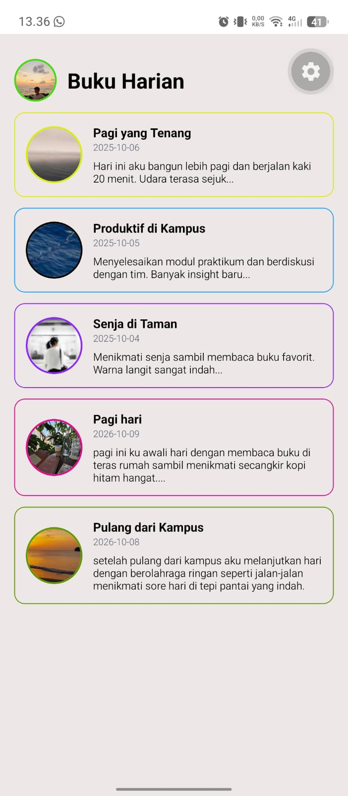

# Diary App

Sebuah aplikasi pencatat harian yang ringkas, dikembangkan dengan React Native dan Expo sebagai bagian dari tugas praktikum Pemrograman Mobile Multiplatform.

## Penulis

**Nama:** Hildan Faris Kamaludin <br>
**NIM:** 2430511059

## Panduan Menjalankan Aplikasi

1. Salin repository atau unduh kode project.
2. Jalankan terminal di dalam direktori project.
3. Pasang seluruh dependensi:

```
npm install
```

4. Mulai aplikasi lewat Expo:

```
npx expo start
```

5. Pindai kode QR lewat aplikasi Expo Go di perangkat Android, atau jalankan melalui emulator.
6. Tekan salah satu kartu catatan untuk membuka modal detail, lalu tekan tombol **Tutup** untuk menutupnya.

## Dependensi

Aplikasi ini memakai:

- React Native
- Expo
- react-native-safe-area-context

## Fitur yang Telah Dikerjakan

- Design tokens terpusat pada `src/styles/tokens.js` (warna, spacing, radius, tipografi, breakpoint) dan dipakai konsisten di seluruh komponen.
- Daftar catatan memakai `FlatList` responsif: 1 kolom pada ponsel dan 2 kolom saat lebar layar >= 600 px.
- `DiaryCard` adalah reusable component dengan prop `variant` (`list` / `grid`) dan dapat ditekan (`Pressable`).
- `DiaryDetailModal` menampilkan hero image, judul, tanggal, dan isi lengkap, serta terbuka ketika kartu ditekan.
- Aksesibilitas dasar: `accessibilityLabel` pada kartu, `accessibilityRole` pada tombol, kontras teks yang cukup, dan target sentuh yang layak (`hitSlop`).
- Memasukkan dua catatan harian baru.
- Memanfaatkan gambar dari internet maupun lokal yang tersimpan di folder `assets/moods`.
- Menampilkan foto profil pengguna di bagian header dengan komponen `Image`.
- Memberikan ragam border serta outline pada kartu sesuai mood.
- Mengatur gambar ke dalam folder `assets/moods` dan tangkapan layar aplikasi di folder `assets/screenshots`.

## Layout Responsif dan Cara Kerja Breakpoint 600 px

Lebar layar dibaca secara reaktif dengan hook `useWindowDimensions()`, lalu dibandingkan dengan nilai breakpoint pada design tokens (`BREAKPOINTS.tablet = 600`):

```js
const { width } = useWindowDimensions();
const twoCols = width >= BREAKPOINTS.tablet; // true jika lebar >= 600 px
```

- Jika `width < 600` (umumnya layar ponsel dalam posisi portrait), `twoCols` bernilai `false`, sehingga `FlatList` memakai `numColumns={1}` dan setiap kartu memakai lebar penuh.
- Jika `width >= 600` (ponsel landscape, tablet, atau jendela web yang dilebarkan), `twoCols` bernilai `true`, sehingga `FlatList` memakai `numColumns={2}` dan kartu dibagi menjadi dua kolom yang sama lebar.

Karena `useWindowDimensions()` otomatis diperbarui ketika ukuran atau orientasi layar berubah, perpindahan dari 1 kolom ke 2 kolom (dan sebaliknya) terjadi tanpa reload. Saat nilai `numColumns` berubah, `FlatList` wajib dibuat ulang agar struktur kolomnya benar, sehingga `key` diisi nilai turunan dari `twoCols`:

```js
const keyForCols = useMemo(() => (twoCols ? "grid2" : "list1"), [twoCols]);
// ...
<FlatList key={keyForCols} numColumns={twoCols ? 2 : 1} ... />
```

Dengan begitu layout tetap rapi, tidak overflow, dan hero image pada modal tetap proporsional berkat `aspectRatio: 16 / 9`.

## Tangkapan Layar

Tampilan aplikasi saat dijalankan di Expo Go:

**1 kolom (lebar layar < 600 px):**

<p align="center">
  
</p>

**2 kolom (lebar layar >= 600 px):**

<p align="center">
  
</p>
